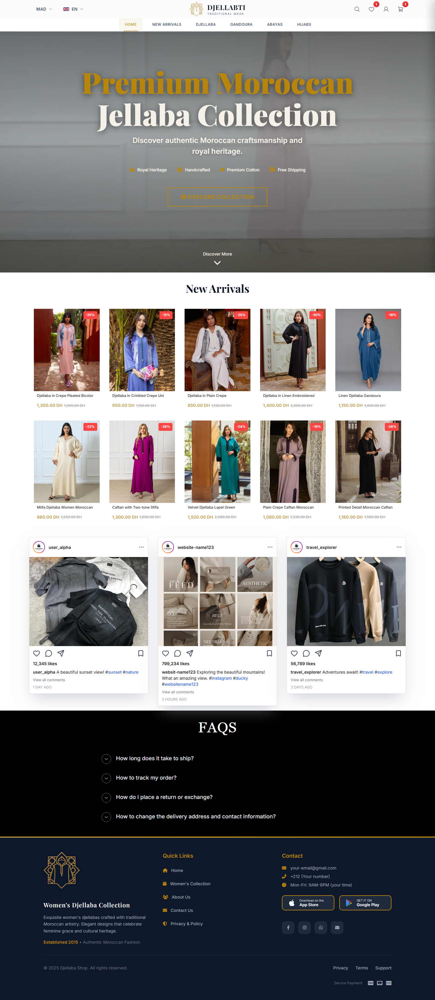
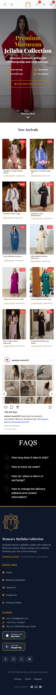
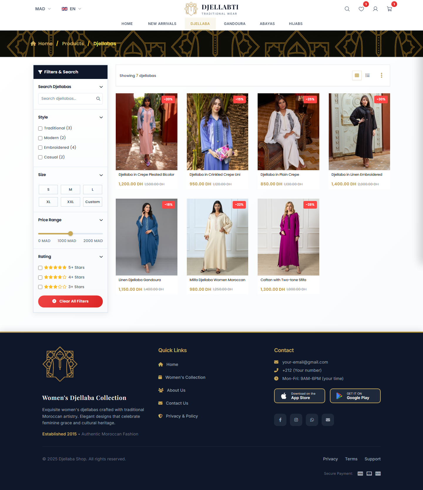
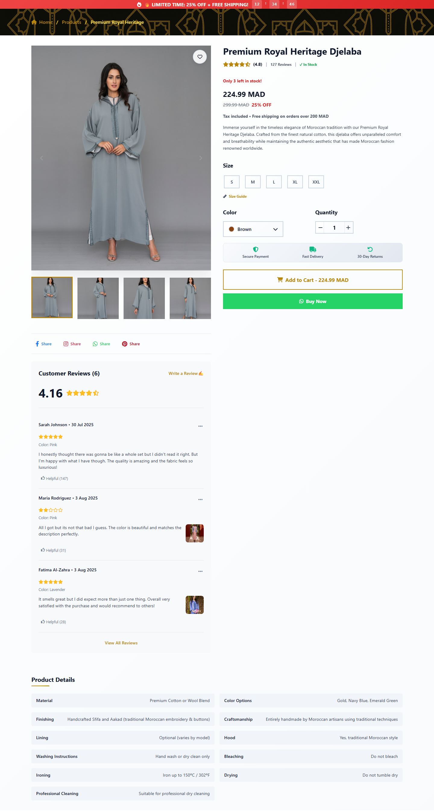
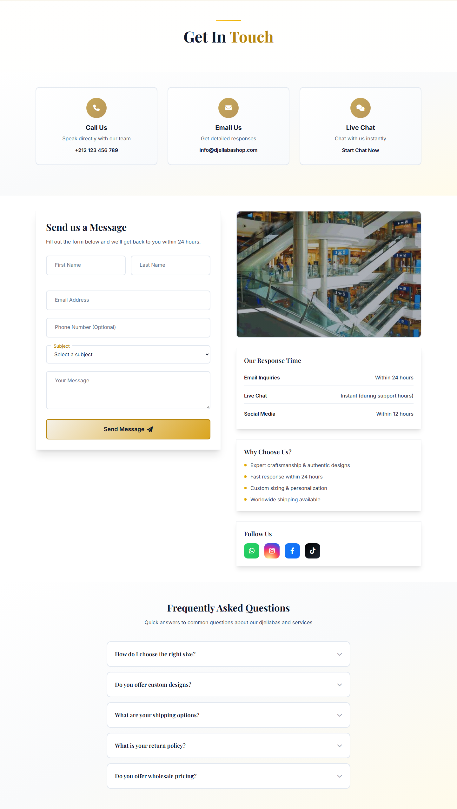
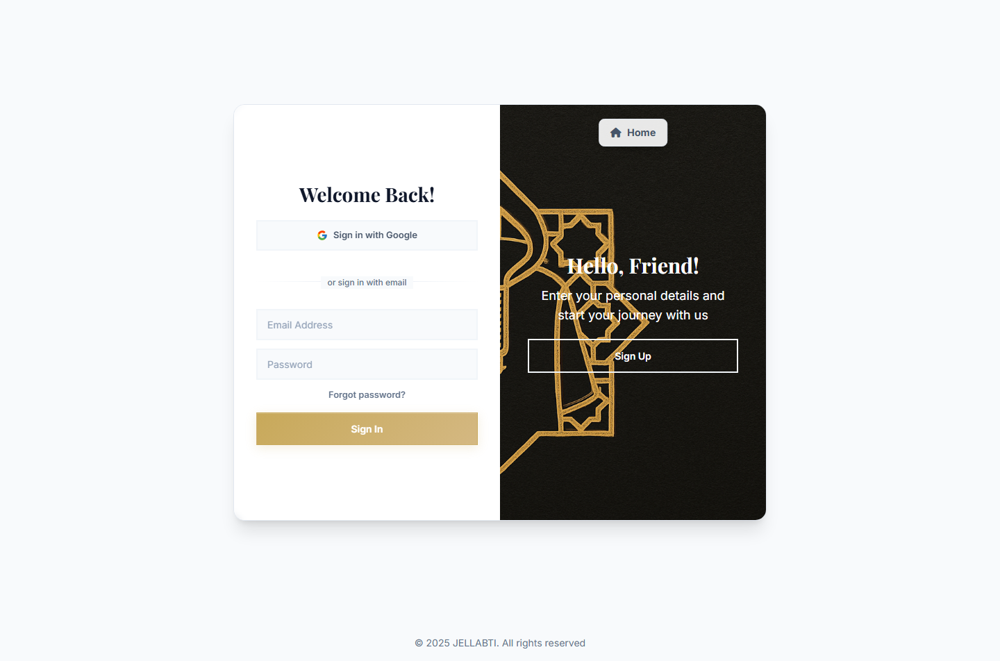

# Moroccan Djellaba Store

A premium, responsive storefront template for a Moroccan djellaba & caftan
boutique, sold under the **DJELLABTI** brand. Built with plain HTML, CSS
(Tailwind CDN + hand-written stylesheets) and vanilla JavaScript — no build
step, no framework, no dependencies to install.

[](https://developer.mozilla.org/docs/Web/HTML)
[](https://developer.mozilla.org/docs/Web/CSS)
[](https://developer.mozilla.org/docs/Web/JavaScript)
[](https://tailwindcss.com)
[](https://fontawesome.com)
[](https://phosphoricons.com)
[](https://fonts.google.com)
[](LICENSE)

## Preview



| Home — mobile | Products | Product detail |
| --- | --- | --- |
|  |  |  |

| Contact | Login |
| --- | --- |
|  |  |

## Pages

| Page | Path | Description |
| --- | --- | --- |
| Home | `index.html` | Hero video, new arrivals, Instagram feed, FAQ and footer |
| Products | `pages/products.html` | Filterable collection grid with quick view |
| Product detail | `pages/product-detail.html` | Gallery, size/colour pickers and related products |
| Contact | `pages/contact.html` | Contact form, store details and support hours |
| Login | `pages/login.html` | Sign-in form |
| Forgot password | `pages/forgot-password.html` | Reset-link request form |
| OTP verification | `pages/otp-verification.html` | One-time-code verification form |

## Features

- Fully responsive layouts, from 390 px phones up to wide desktop screens.
- Reusable UI components (header, hero, new arrivals, Instagram feed, FAQ,
  footer, quick view, wishlist/cart drawers) shared across the pages.
- Slide-out wishlist and shopping-cart drawers with live counters.
- Hero section backed by a looping video with a poster-style gradient overlay.
- Skeleton loading states and scroll-triggered reveal animations.
- Accessible markup: semantic landmarks, `aria` labels and focus styles.

## Tech stack

| Layer | Choice |
| --- | --- |
| Markup | HTML5 |
| Styling | [Tailwind CSS](https://tailwindcss.com) (CDN) + custom CSS |
| Behaviour | Vanilla JavaScript (ES2015+) |
| Icons | Font Awesome 6, Phosphor Icons, Lucide |
| Type | Google Fonts — Inter, Playfair Display, Cormorant Garamond |

## Project structure

```
.
├── index.html                  # Composed home page
├── components/                 # Standalone component previews
│   ├── header.html
│   ├── hero.html
│   ├── new-arrivals.html
│   ├── instagram-feed.html
│   ├── faq.html
│   └── footer.html
├── pages/                      # Every other page of the storefront
├── assets/
│   ├── css/
│   │   ├── components/         # One stylesheet per component
│   │   └── pages/              # Page-level and composition styles
│   ├── js/
│   │   ├── components/         # Component behaviour + Tailwind theme config
│   │   └── pages/              # Page behaviour + Tailwind theme config
│   ├── images/                 # Logo and pattern assets
│   └── media/                  # Hero video
└── docs/screenshots/           # README screenshots
```

Each component ships its own stylesheet and script, so a component can be
previewed on its own from `components/` and then reused on any page. Pages
that stack several components (like the home page) load a small composition
stylesheet, `assets/css/pages/home.css`, which pins the page-level look back to
what each section expects.

The content pages — `pages/products.html`, `pages/product-detail.html` and
`pages/contact.html` — embed the shared header and footer markup directly, so
the navigation and footer links work everywhere. They also load
`assets/css/components/page-chrome.css`, which reserves room for the fixed
header and keeps the chrome identical on every host page. The auth pages
(`login`, `forgot-password`, `otp-verification`) use their own slim headers
instead.

## Getting started

Everything is static, so you can simply open `index.html` in a browser. Some
browsers restrict local file access, so serving the folder over HTTP is
recommended:

```bash
# Python 3
python -m http.server 4173

# or Node.js
npx serve .
```

Then visit <http://localhost:4173>.

## Customisation

- **Colours & fonts** — the Tailwind theme is defined in the `tailwind.config`
  blocks of `assets/js/pages/*.config.js` and `assets/js/components/*.config.js`.
  Each page and component declares its own subset of the theme, so update the
  config next to the file you are editing.
- **Products & copy** — the demo catalogue is defined in the `assets/js/**`
  files next to each page. Product photography is loaded from a remote image
  CDN, so no local image files are required.
- **Sections on the home page** — edit the matching file in `components/` and
  copy the change into the composed `index.html`.

## Contributing

See [CONTRIBUTING.md](CONTRIBUTING.md).

## License

Released under the [MIT License](LICENSE).
